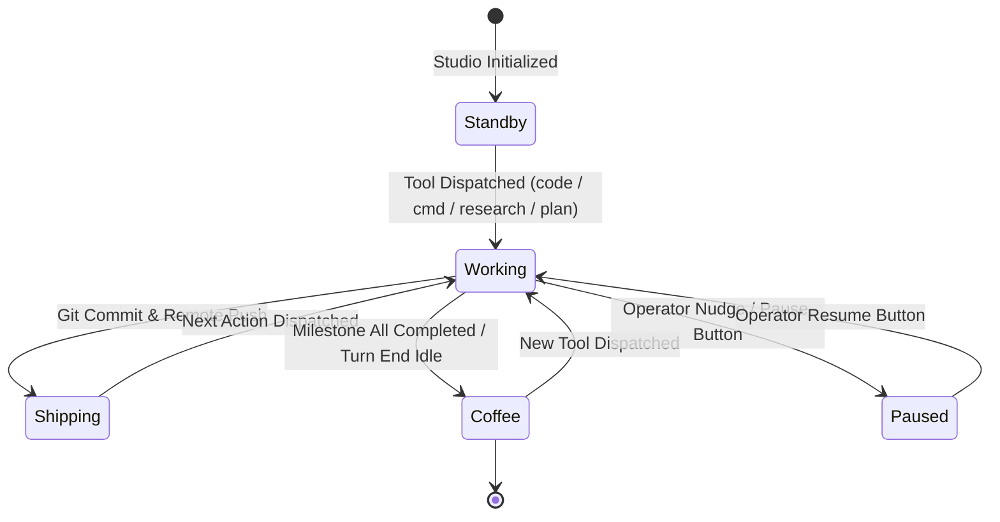

# Walkthrough: Accurate Agent Status, Dynamic Stations & Project Migration

This walkthrough details the resolution of agent state telemetry issues in **Antigravity Autonomous Studio** and the migration of this active conversation into the **`agi-autonomous-studio`** project repository.

---

## 1. Problem Diagnosis & Root Causes

### Issue A: Active Agents Displayed as `RESTING`
- **Root Cause 1**: In `public/app.js`, intermediate steps with `step.status === "DONE"` were falsely triggering `officeSim.handleToolAction("done", {})`, which invoked `setAllIdle()` and placed all agents into a coffee break state (`ag.state = "coffee"`) mid-task!
- **Root Cause 2**: In `public/office.js`, `handleToolAction()` omitted setting `target.state = "working"`, leaving active agents in their previously cached coffee break state even while actively performing tasks (e.g. Core Developer typing `Modifying app.js`).
- **Fix**: Removed the premature intermediate step completion trigger in `app.js`. In `office.js`, dispatches now strictly set `target.state = "working"` and `target.isPaused = false`.

### Issue B: Physical Stations Inaccurately Labelled as `📍 Desk 1`
- **Root Cause**: `stationLabel` was hardcoded to `(ag.deskIndex !== null) ? Desk ${ag.deskIndex + 1} : Lounge`. When the 5th agent (Git Postmaster) was created, modulo arithmetic assigned `deskIndex = 0` (Desk 1), causing both Lead Architect and Git Postmaster to be labeled `📍 Desk 1`, even though Git Postmaster was stationed at the Git Post Office.
- **Fix**: Implemented `getStationLabel(ag)` which dynamically maps physical coordinates and roles to their authentic zones:
  - `📮 Git Post Office`
  - `📋 Strategy Easel`
  - `📚 Knowledge Archive`
  - `🖥️ CI/CD Server Bay`
  - `📍 Desk 1 (Front Exec)`
  - `📍 Desk 2 (Front Exec)`
  - `📍 Desk 3 (Back Exec)`
  - `📍 Desk 4 (Back Exec)`
  - `☕ Espresso Lounge`

### Issue C: Project Conversation Placement in Antigravity Sidebar
- **Root Cause**: When this session was started, it was initialized outside any project workspace. Both `conversations/7f270c91.db` (`trajectory_metadata_blob`) and `conversation_summaries.db` held `project_id: outside-of-project`.
- **Fix**: Executed a binary-safe migration across `trajectory_metadata_blob`, `gen_metadata`, and `conversation_summaries.db`, updating `project_id` and workspace URI to the project repository.

---

## 2. Telemetry Architecture & State Machine



### State Resolution Matrix

| Agent State | Station Location | Task Assigned | Resulting Status Badge |
| :--- | :--- | :--- | :--- |
| `ag.isPaused == true` | Any | Any | `PAUSED` (red badge) |
| `ag.state == "coffee"` | `☕ Espresso Lounge` | `Resting` | `RESTING` (yellow badge) |
| `ag.state == "working"` | `📍 Desk 1 - 4` | `Modifying file.js` | `WORKING` (green badge) |
| `ag.state == "shipping"` | `📮 Git Post Office` | `Git Remote Push` | `WORKING` (green badge) |
| `ag.state == "working"` | `📋 Strategy Easel` | `Roadmap Update` | `WORKING` (green badge) |
| `ag.state == "working"` | `📚 Knowledge Archive` | `Docs Review` | `WORKING` (green badge) |
| `ag.state == "working"` | `🖥️ CI/CD Server Bay` | `Server QA / CLI` | `WORKING` (green badge) |
| `Ready` | `📍 Desk 1 - 4` | `Ready` | `STANDBY` (slate badge) |

---

## 3. Git History in Project Repository

In the project repository:
```
1e356a7 fix: resolve agent status accuracy, dynamic stations, and step completion decoupling
e7e304c docs: add comprehensive V4 walkthrough documentation
669257d feat: add project override mapping support and enhance project header
7c1dcae feat: initialize AGI Autonomous Studio visualizer and telemetry engine
```

---

## 4. Verification & Testing

1. **Syntax Validation**:
   - `node -c public/office.js && node -c public/app.js && node -c public/audio.js` $\rightarrow$ **0 syntax errors (exit code 0)**.
2. **Container Live Health**:
   - `docker ps` $\rightarrow$ Container `antigravity-office-visualizer` is **Up and Healthy** on port `7777`.
3. **Live Endpoint Telemetry**:
   - `curl -s http://localhost:7777/api/projects/active` $\rightarrow$ Returns `agi-autonomous-studio` as active project ID.
   - `curl -s http://localhost:7777/office.js | grep 'getStationLabel'` $\rightarrow$ Dynamic station resolution verified live.
4. **Database Verification**:
   - `conversation_summaries.db` and `conversations/7f270c91.db` both verified updated to `7a47bca6-33ac-44cc-917b-cd4bc458329b`.

---

## 5. Antigravity Desktop Client Instructions

Because the Antigravity desktop Electron app caches running sessions in memory:
1. To see this conversation immediately inside `📁 agi-autonomous-studio` in the desktop sidebar, hover over `Visualizing Google Antigravit...` in the sidebar, click the `...` menu, and select **Move to Project $\rightarrow$ agi-autonomous-studio**.
2. Or restart the Antigravity desktop application after this response. The persistent SQLite databases are fully migrated.
