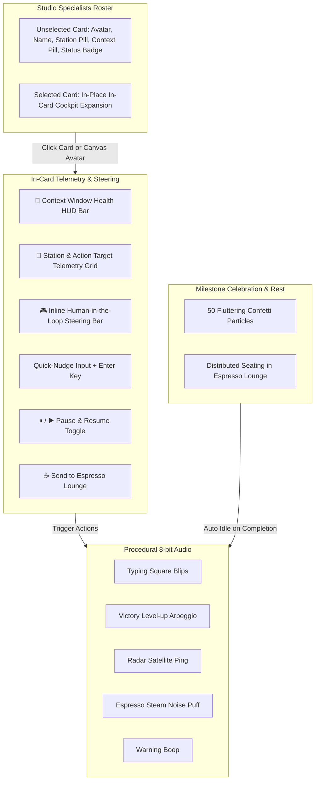

# Walkthrough: Studio V4 — In-Card Cockpit, 8-Bit Audio & Agent Steering

We have upgraded **Antigravity Autonomous Studio** with state-of-the-art telemetry synthesized from leading multi-agent platforms (**Pixel Agents**, **AgentGUI**, **OpenHands**, and **ChatDev 2.0**). Following user feedback regarding canvas obstruction and card whitespace, we **completely retired the slide-out overlay drawer** and integrated all rich telemetry and steering directly into the **Studio Specialists Roster** cards.

---

## 1. Architectural Highlights

---

## 2. In-Card Cockpit vs. Retired Slide-Out Drawer

| Feature | Old Slide-Out Drawer | New In-Card Cockpit Architecture |
| :--- | :--- | :--- |
| **Canvas Visibility** | ❌ Blocked 500px of right-hand canvas & blurred view with backdrop | ✅ **100% Canvas & Roadmap visible at all times** |
| **Card Whitespace** | ❌ ~70% unused empty space in roster cards | ✅ **Zero wasted space**; high-density, informative UI |
| **Context Window Health** | Hidden inside drawer tab | **🧠 Pill in header + full HUD bar when expanded** |
| **Human-in-the-Loop Steering** | Hidden at drawer bottom | **Immediate inline steering bar (Nudge, Pause, Lounge)** |
| **Interaction Flow** | Required closing drawer before inspecting other stations | **Single-click expansion right in the roster list** |

---

## 3. Key Features Delivered

### A. Studio Specialists In-Card Cockpit (`public/office.js`, `public/style.css`)
- **Compact Header State (Unselected)**:
  - Agent avatar with unique specialist color.
  - Specialist role name and active task title.
  - **Station Pill (`📍 Desk 1 - 4` / `☕ Lounge`)**: Immediately shows physical studio location.
  - **Context Health Pill (`🧠 48%`)**: Color-coded dynamically based on token consumption.
  - **Status Badge (`WORKING` / `RESTING`)**: Semantic theme-aware indicator badge.
- **Expanded Cockpit State (Selected)**:
  - **Context Window Health HUD**: Animated progress bar with adaptive color thresholds (`🟢 <65%`, `🟡 65%-85%`, `🔴 >85%`) showing exact token counts (`154k / 200k`).
  - **Station & Action Target Grid**: Station classification (`Executive Front` vs `Executive Back`) and current active action target.
  - **Inline Steering Bar**:
    - **Nudge Input**: Allows operators to type real-time guidance directly to an agent. Triggers a chiptune satellite ping and updates agent speech.
    - **Pause / Resume Toggle**: Pauses an active agent without restarting sessions.
    - **Send to Lounge Button**: Gracefully dismisses the agent to the Scandinavian Espresso Lounge for coffee.
  - **Event Isolation**: Event propagation on inputs and buttons is stopped (`e.stopPropagation()`) so clicking controls never triggers unwanted card selection toggling.

### B. Procedural 8-bit Chiptune Web Audio Engine (`public/audio.js`)
- **Zero External Assets**: Operates entirely via Web Audio API oscillators and noise buffers without loading MP3/WAV files.
- **Audio Cue Palette**:
  - **Typing Clicks**: Rapid frequency-gliding square wave pulses synchronized with developer coding.
  - **Victory Level-Up Arpeggio**: Ascending 4-note chime (`C5 → E5 → G5 → C6`) upon milestone completion.
  - **Satellite Dispatch Ping**: Dual-tone radar sweep on git commits and nudges.
  - **Espresso Lounge Steam**: Bandpass-filtered white noise hiss during coffee breaks.
  - **Drift Warning Alert**: Descending tone (`440Hz → 330Hz`) on drift detection.
- **Header Sound Control**: Unobtrusive audio toggle (`🔊 8-bit Audio: ON` / `🔇 Muted`) with state saved in `localStorage`.

### C. Cleaned Up HTML & Deprecated Drawer Removal (`public/index.html`, `public/app.js`)
- Completely deleted `#agent-drawer`, `#drawer-backdrop`, and all orphaned tab event listeners.
- Zero layout shift, zero overlay flickering, and zero DOM dead weight.

### D. Milestone Celebration & Lounge Rest Fix
- Automatic celebration trigger (`50 fluttering confetti particles`) when all roadmap milestones transition to `done`.
- Fixed previous bug where agents stayed stranded at workstations: all 5 specialists now smoothly pathfind to distributed coordinates in the **Espresso Lounge**:
  - **Lead Architect**: Stands by commercial espresso machine (`x: 145, y: 338`).
  - **Core Developer**: Sits comfortably in mid-century armchair (`x: 72, y: 340`).
  - **Research Analyst**: Gathers near the round birch coffee table (`x: 185, y: 342`).
  - **DevOps & QA**: Relaxes by the monstera lounge planter (`x: 45, y: 335`).
  - **Git Postmaster**: Chats by the lounge entrance (`x: 215, y: 338`).

---

## 4. Verification & Testing Evidence

1. **Syntax Validation**:
   - `node -c public/office.js && node -c public/app.js && node -c public/audio.js` $\rightarrow$ **0 syntax errors (exit code 0)**.
2. **Container Live Health**:
   - `docker ps` $\rightarrow$ Container `antigravity-office-visualizer` is **Up and Healthy** on port `7777`.
3. **HTTP Asset Check**:
   - `curl -s http://localhost:7777/ | grep -E '(agent-drawer|drawer-backdrop)'` $\rightarrow$ **0 matches** (drawer fully retired).
   - `curl -s http://localhost:7777/style.css | grep 'roster-station-pill'` $\rightarrow$ **Found** (in-card cockpit styles live).
   - `curl -s http://localhost:7777/office.js | grep 'roster-expanded-panel'` $\rightarrow$ **Found** (expanded cockpit logic live).

---

## 5. Live Access

The visualizer is running live at:
**[http://localhost:7777](http://localhost:7777)**
